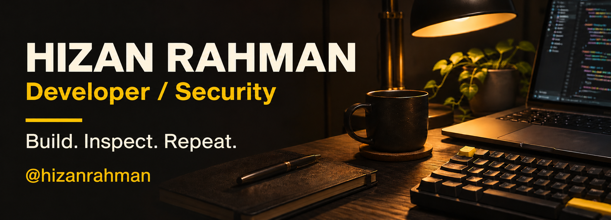

<!-- Profile README for github.com/hizanrahman. Keep assets/banner-helvetica.png beside this file in assets/. -->

  

  <strong>Developer · Security enthusiast · Founder of DroidSec Community</strong>

  <a href="https://portfolio-smoky-three-a9j53rkdhh.vercel.app">Portfolio</a>
  &nbsp; / &nbsp;
  <a href="https://www.linkedin.com/in/hizanrahman/">LinkedIn</a>
  &nbsp; / &nbsp;
  <a href="mailto:hizanrahman@gmail.com">Email</a>
  &nbsp; / &nbsp;
  <a href="https://droidsec.vercel.app">DroidSec</a>

---

### `01 / whoami`

Hey, I'm **Hizan**. I build web applications and explore how the systems behind them work: the interface, the API, the network, and, lately, the smart contract.

My work spans **React and Node.js applications**, **hands-on security labs**, and **Ethereum experiments**. I also founded **[DroidSec Community](https://droidsec.vercel.app)**, a space for security enthusiasts to learn and collaborate.

> Build something useful. Ask how it could break. Come back with a better version.

### `02 / selected builds`

<table>
  <tr>
    <td width="50%" valign="top">
      <h3>01 &nbsp; Chain Note</h3>
      
<strong>A message board with an onchain memory.</strong>

      
A decentralized message board on Ethereum Sepolia. Connect a wallet, publish a note, and track its author, revision, and transaction status.

      
<code>Solidity</code> <code>ethers.js</code> <code>JavaScript</code> <code>Vite</code>

      
<a href="https://github.com/hizanrahman/chain-note-dapp">Explore the code ↗</a> &nbsp; · &nbsp; <a href="https://sepolia.etherscan.io/address/0x02268EC106FC5bec024b30e0Ad2bD6f295aB771b">Sepolia contract ↗</a>

    </td>
    <td width="50%" valign="top">
      <h3>02 &nbsp; PMI AudioBook</h3>
      
<strong>From a book library to the play button.</strong>

      
A MERN audiobook platform with chapter playback, book and audio uploads, authentication, and role-based administration.

      
<code>React</code> <code>Node.js</code> <code>Express</code> <code>MongoDB</code>

      
<a href="https://github.com/hizanrahman/PMI-AudioBook-TEST">Explore the code ↗</a>

    </td>
  </tr>
  <tr>
    <td width="50%" valign="top">
      <h3>03 &nbsp; IEEE IAS · CEK</h3>
      
<strong>A digital home for a student chapter.</strong>

      
A website for the IEEE Industry Applications Society chapter at College of Engineering Karunagappally, with activities, achievements, and team pages.

      
<code>Next.js</code> <code>TypeScript</code> <code>Tailwind CSS</code>

      
<a href="https://github.com/hizanrahman/ieee-cek-ias-chapter">Explore the code ↗</a>

    </td>
    <td width="50%" valign="top">
      <h3>04 &nbsp; Security Field Notes</h3>
      
<strong>Follow the packets. Understand the system.</strong>

      
Hands-on exercises from my Elevate Labs internship: network discovery, traffic analysis, vulnerability scanning, and security fundamentals.

      
<code>Nmap</code> <code>Wireshark</code> <code>Nessus</code>

      
<a href="https://github.com/hizanrahman/Elevate_Labs_Internship">Read the lab notes ↗</a>

    </td>
  </tr>
</table>

  <a href="https://github.com/hizanrahman?tab=repositories">Browse the rest of the workbench →</a>

### `03 / tools on the bench`

| Area | Tools I've worked with |
| :--- | :--- |
| **Interfaces** | React · Next.js · TypeScript · Tailwind CSS |
| **Application logic** | JavaScript · Node.js · Express · Python |
| **Data & identity** | MongoDB · Mongoose · JWT |
| **Onchain experiments** | Solidity · ethers.js · Ethereum Sepolia |
| **Security labs** | Nmap · Wireshark · Nessus |
| **Build & delivery** | Git · GitHub Actions · Vite · Vercel |

  
<strong>Open the learning archive</strong>

Every project starts somewhere. Mine includes Python exercises, small scripts, and plenty of practice:

- [Python Basics](https://github.com/hizanrahman/Python-Basics) — foundational exercises.
- [ZTM Python coursework](https://github.com/hizanrahman/All-Python-codes-of-ZTM-course-by-Andrei-Neagoie) — code from Andrei Neagoie's course.
- [Personal portfolio](https://github.com/hizanrahman/portfolio) — a React and TypeScript home for my work.

### `04 / let's connect`

Have a web project, a security learning idea, or a curious technical problem? Let's talk.

**[Say hello by email](mailto:hizanrahman@gmail.com)** · **[Connect on LinkedIn](https://www.linkedin.com/in/hizanrahman/)** · **[Explore DroidSec](https://droidsec.vercel.app)**

---

  Curiosity is the starting point. The repository is the work in progress.

